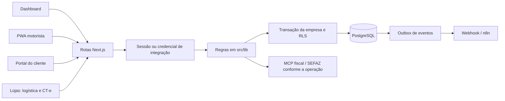

# Arquitetura técnica do TMS

Este documento descreve o código da aplicação e suas fronteiras. Para regras
de uso, veja o [README](README.md); para evolução desejada, o
[roadmap](docs/ROADMAP.md). A revisão documental não executa integrações fiscais
nem declara homologação em produção.

## Componentes e fluxo de uma requisição

O [package.json](package.json) declara Next.js 16.2.12, React 19.2.4, Prisma 7,
TypeScript e NextAuth 4. O servidor usa PostgreSQL por meio de `pg` e
`@prisma/adapter-pg`. O lockfile registra as versões efetivamente resolvidas.

1. `src/app` fornece páginas e handlers HTTP do App Router.
2. [src/proxy.ts](src/proxy.ts) separa áreas de navegação. A autorização das
   APIs é conferida de novo no servidor; a proteção de página não a substitui.
3. [staff.ts](src/lib/staff.ts) resolve sessão, relê o usuário no banco e exige
   uma capacidade de [permissoes.ts](src/lib/permissoes.ts).
4. Regras, validação e contratos estão em `src/lib`. Vários módulos separam
   funções puras em `modulo.ts` e persistência em `modulo-db.ts`.
5. [prisma.ts](src/lib/prisma.ts) configura a empresa na transação; o PostgreSQL
   aplica as políticas de [010-rls.sql](prisma/sql/010-rls.sql).

## Interfaces

| Interface | Entrada | Responsabilidade |
| --- | --- | --- |
| Gestão | `/dashboard` | Operação, comercial, fiscal, financeiro e administração conforme capacidade |
| Motorista | `/driver` | Viagens, entregas, comprovantes, ocorrências, GPS e fila offline |
| Cliente | `/portal` | Coletas, cotações, destinatários, faturas e documentos próprios |
| Plataforma | `/plataforma` | Administração de empresas conforme autorização específica |
| Pública | `/api/cotacoes`, `/api/leads`, `/api/rastreio` | Cotação, lead e rastreio consumidos pelo site do transportador |
| Integração Lojas | `/api/integracoes/lojas/v1/empresas/[empresa]` | Contratos autenticados por empresa, independentes da sessão do painel |

## Funções de cada módulo

Os caminhos abaixo levam às implementações. O README mantém as regras de
negócio detalhadas, matrizes de perfis e limites de cada fluxo.

| Módulo | Funções e responsabilidades | Implementações principais |
| --- | --- | --- |
| Identidade | Login, sessão, usuário atual e encerramento de sessão | [auth](src/lib/auth.ts), [usuario-logado](src/lib/usuario-logado.ts), [sair](src/lib/sair.ts) |
| Autorização | Matriz de capacidades e conferência de perfil atual nas APIs | [permissoes](src/lib/permissoes.ts), [staff](src/lib/staff.ts), [proxy](src/proxy.ts) |
| Empresas e acessos | Cadastro de empresas, parâmetros, convites, liberação e revogação de acesso | [empresas](src/lib/empresas.ts), [empresa](src/lib/empresa.ts), [plataforma](src/lib/plataforma.ts), [acessos](src/lib/acessos.ts), [usuarios](src/lib/usuarios.ts) |
| Persistência | Cliente por sessão, cliente por empresa explícita e transações isoladas | [prisma](src/lib/prisma.ts), [schema](prisma/schema.prisma) |
| Cadastros | Normalização, validação e consulta de dados cadastrais | [cadastros](src/lib/cadastros.ts), [normalization](src/lib/normalization.ts), [brasilApi](src/lib/brasilApi.ts) |
| Comercial | Lead, funil, cotação e texto da proposta comercial | [crm](src/lib/crm.ts), [crm-db](src/lib/crm-db.ts), [cotacao](src/lib/cotacao.ts), [proposta](src/lib/proposta-cotacao.ts) |
| Frete | Tabelas, valor de coleta, dimensões e cubagem dos volumes | [frete](src/lib/frete.ts), [frete-coleta](src/lib/frete-coleta.ts), [dimensoes](src/lib/dimensoes-volume.ts) |
| Coletas e minutas | Validação da carga, criação confirmada, histórico, código de rastreio e minuta imprimível | [coletas](src/lib/coletas.ts), [coletas-db](src/lib/coletas-db.ts), [historico](src/lib/historico.ts), [minuta](src/lib/minuta.ts) |
| Manifestos e viagens | Agrupamento de cargas, estados da viagem, despesas e acerto | [manifestos](src/lib/manifestos.ts), [manifestos-db](src/lib/manifestos-db.ts), [viagem](src/lib/viagem.ts), [viagem-db](src/lib/viagem-db.ts) |
| Capacidade da frota | Ocupação em peso/cubagem e avaliação de veículos para a carga | [ocupacao](src/lib/ocupacao.ts), [adequacao-veiculo](src/lib/adequacao-veiculo.ts) |
| Entregas e rastreio | Estados de entrega, consulta pública e dados do motorista | [entregas](src/lib/entregas.ts), [tracking](src/lib/tracking.ts), [driver](src/lib/driver.ts) |
| Motorista offline | Fila local de ações, localização e sincronização de operação | [offline-queue](src/lib/offline-queue.ts), [gps-motorista](src/lib/gps-motorista.ts), [service worker](public/sw.js) |
| Comprovantes | Perfis de POD, fotos, assinatura, conferência e devolução ao motorista | [comprovantes](src/lib/comprovantes.ts), [comprovantes-db](src/lib/comprovantes-db.ts), [motorista](src/lib/comprovantes-motorista.ts), [assinatura](src/lib/assinatura.ts), [foto](src/lib/foto.ts) |
| Depósito | Conferência, recebimento, posições e identificação dos volumes | [deposito](src/lib/deposito.ts), [deposito-db](src/lib/deposito-db.ts), [posicao](src/lib/posicao.ts), [posicao-db](src/lib/posicao-db.ts), [code128](src/lib/code128.ts) |
| Rotas e mapa | Geocodificação, municípios, ordem das paradas e distância de rota | [roteiro](src/lib/roteiro.ts), [geo](src/lib/geo.ts), [geo-db](src/lib/geo-db.ts), [rota-osrm](src/lib/rota-osrm.ts), [mapa](src/lib/mapa.ts), [mapa-db](src/lib/mapa-db.ts), [municipios](src/lib/municipios.ts) |
| Faturamento | Seleção de cargas faturáveis, emissão e ações da fatura | [faturas](src/lib/faturas.ts), [faturas-db](src/lib/faturas-db.ts) |
| Financeiro | Contas, baixa, encargos, resumo e fluxo de caixa | [financeiro](src/lib/financeiro.ts), [financeiro-db](src/lib/financeiro-db.ts) |
| Conciliação | Leitura de OFX e conciliação dos movimentos | [ofx](src/lib/ofx.ts), [conciliacao](src/lib/conciliacao.ts), [conciliacao-db](src/lib/conciliacao-db.ts) |
| Cobrança | Vencimentos, Pix, gateway por empresa e conferência dos pagamentos | [cobranca](src/lib/cobranca.ts), [pix](src/lib/pix.ts), [gateway](src/lib/cobranca-gateway.ts), [gateway-db](src/lib/cobranca-gateway-db.ts), [mercado-pago](src/lib/mercado-pago.ts) |
| Frota | Manutenção, abastecimento, pneus, documentos e checklist | [frota](src/lib/frota.ts), [frota-db](src/lib/frota-db.ts) |
| Equipe | Ajudantes, ausências, adiantamentos, remuneração e fechamento | [equipe](src/lib/equipe.ts), [equipe-db](src/lib/equipe-db.ts), [remuneracao](src/lib/remuneracao.ts), [remuneracao-db](src/lib/remuneracao-db.ts) |
| Parceiros | Cadastro de terceiros, frete contratado e documentos de subcontratação | [parceiros](src/lib/parceiros.ts), [frete-contratado](src/lib/frete-contratado.ts), [frete-contratado-db](src/lib/frete-contratado-db.ts), [subcontratacao](src/lib/subcontratacao.ts), [subcontratacao-db](src/lib/subcontratacao-db.ts), [redespacho](src/lib/redespacho.ts) |
| Ocorrências | Abertura, mensagens e tratamento dos chamados | [ocorrencias](src/lib/ocorrencias.ts), [ocorrencias-db](src/lib/ocorrencias-db.ts) |
| NF-e | Parser XML, conferência da chave, sugestão de carga, importação e vínculo da nota à carga | [nfe](src/lib/nfe.ts), [nfe-db](src/lib/nfe-db.ts), [chave-dfe](src/lib/chave-dfe.ts), [rotas](src/app/api/fiscal/notas/route.ts) |
| CT-e | Preparação, XML, assinatura, transmissão, consultas, eventos e persistência | [cte](src/lib/cte.ts), [cte-db](src/lib/cte-db.ts), [protocolo e construção](src/lib/cte) |
| MDF-e | Conferência da viagem, montagem, emissão, contingência, eventos e encerramento | [mdfe](src/lib/mdfe.ts), [mdfe-db](src/lib/mdfe-db.ts), [protocolo e construção](src/lib/mdfe) |
| Documentos auxiliares | Conversa MCP, leitura de resposta JSON/SSE, validação e download dos PDFs | [fiscal-mcp](src/lib/fiscal-mcp.ts) |
| Integração Lojas | Autenticação por empresa, cotação, remessa, reversa e apresentação do CT-e | [lojas-logistica-auth](src/lib/lojas-logistica-auth.ts), [contrato](src/lib/lojas-logistica.ts), [persistência](src/lib/lojas-logistica-db.ts), [CT-e](src/lib/cte-integracao-lojas.ts) |
| Mensageria | Outbox, entrega de eventos, tentativas, seleção de destinatários e reenvio | [eventos](src/lib/eventos.ts), [mensageria](src/lib/mensageria.ts), [roteamento-documentos](src/lib/roteamento-documentos.ts) |
| Notificações | Avisos internos, push e destinatários de notificações do cliente | [notificacoes](src/lib/notificacoes.ts), [push](src/lib/notificacoes-push.ts), [push-cliente](src/lib/push-cliente.ts) |
| Auditoria e relatórios | Registro de ações e projeções gerenciais autorizadas | [auditoria](src/lib/auditoria.ts), [relatorios](src/lib/relatorios.ts) |
| Portal | Validação da sessão do cliente e operações da própria empresa/cliente | [portal](src/lib/portal.ts), [portal-cliente](src/lib/portal-cliente.ts) |
| Apoio transversal | Formatação, valores monetários, endereços, rate limit e validação de URL pública | [format](src/lib/format.ts), [cifra](src/lib/cifra.ts), [endereco](src/lib/endereco.ts), [rate-limit](src/lib/rate-limit.ts), [url-publica](src/lib/url-publica.ts), [utils](src/lib/utils.ts) |

## Isolamento e transações

O [schema](prisma/schema.prisma) associa os dados de negócio a `Tenant`.
`empresaAtual()` obtém `tenantId` da sessão; `prisma` envolve a operação em
transação com `SET LOCAL` equivalente por `set_config`, papel `tms_app` e
`app.tenant_id`. Sem empresa válida, lança `SemEmpresaError`.

`transacao()` agrupa mudanças atômicas da empresa atual. `paraEmpresa(id)` é a
entrada para uma empresa explicitamente autenticada. `sistema` é uma exceção
para fluxos transversais e anteriores à seleção da empresa; não é o cliente
normal de rotas de negócio. Veja [prisma.ts](src/lib/prisma.ts) e os
[testes de isolamento](tests/multi-tenant.test.ts).

## Eventos e processos em segundo plano

[src/instrumentation.ts](src/instrumentation.ts) inicia o despachante de
[eventos.ts](src/lib/eventos.ts). Eventos persistidos em `OutboxEvent` guardam
as tentativas; entrega HTTP usa assinatura HMAC e limites de tempo. Push,
geocodificação, cobrança e avisos de MDF-e têm seus caminhos no mesmo módulo.
`roteamento-documentos.ts` seleciona destinatários e documentos solicitados;
essa seleção não envia o arquivo nem comprova entrega.

O timer de um processo não equivale a um worker fiscal independente. Para o
Monitor de Notas, suas fontes e a separação de responsabilidades, consulte
[MONITOR-NOTAS.md](docs/MONITOR-NOTAS.md).

## Construção, testes e publicação

O [workflow](.github/workflows/deploy-production.yml) possui a cadeia
`checks → image → deploy`. `checks` prepara PostgreSQL 18 isolado, gera o
cliente Prisma, aplica o schema/políticas e executa typecheck e Vitest.
`image` constrói a imagem do [Dockerfile](Dockerfile) e, fora de PR, publica no
GHCR. O deploy exige a branch principal, a variável `DEPLOY_ENABLED` e os
segredos de SSH configurados; usa a imagem por digest e verifica saúde.

Builds de aplicação são executados somente pelo GitHub CI. Não executar código
de aplicação, testes, migrações ou build no servidor `applications`. Nenhuma
verificação documental autoriza emissão fiscal, envio a clientes ou alteração
de banco de produção.
